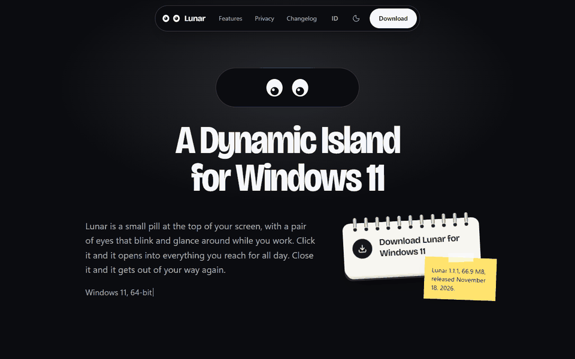
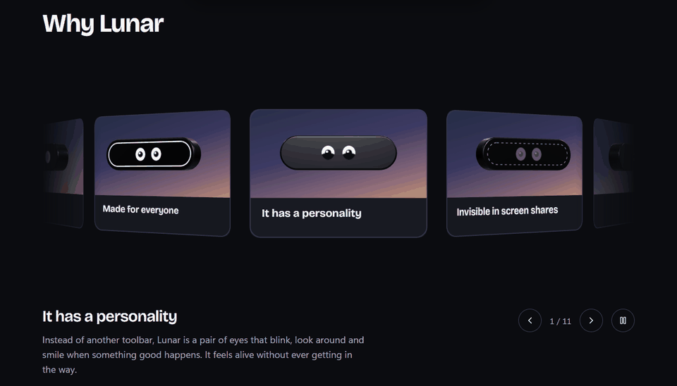
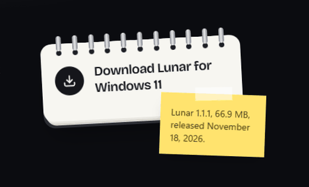
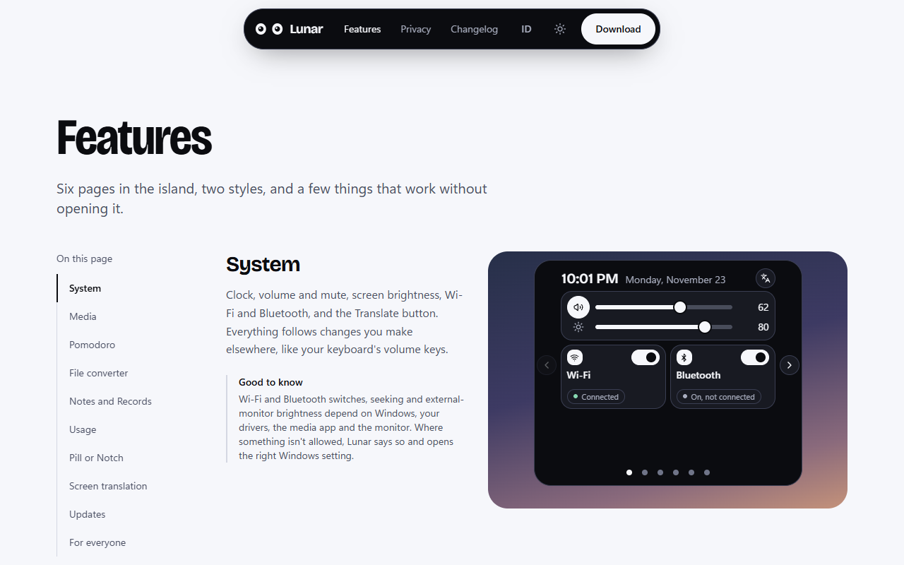
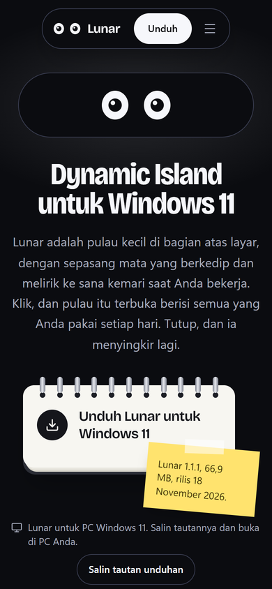
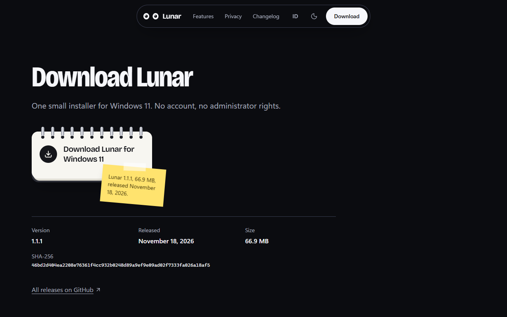

<div align="center">

# Lunar Website

**The showcase site for [Lunar](https://github.com/rafaelevan-k/lunar), a Dynamic Island for Windows 11.**

A pair of eyes at the top of your screen that blink, glance around, and open into everything you reach for all day.
This site lets you meet them before you install anything.

[**Visit the site →**](https://lunar.rafaelevank.tech) &nbsp;·&nbsp;
[Get Lunar](https://github.com/rafaelevan-k/lunar/releases/latest) &nbsp;·&nbsp;
[Lunar on GitHub](https://github.com/rafaelevan-k/lunar)

[](https://github.com/rafaelevan-k/lunar-website/actions/workflows/ci.yml)



</div>

## What's on the site

### Lunar is the star

The big pill in the hero is Lunar itself, drawn from the app's own design. Its eyes follow your pointer, blink at
random, and smile when you reach for the download. Below it, the facts type themselves out one at a time.

### Why Lunar, on a 3D arc

Eleven reasons stand on an endless arc, each with Lunar's island in 3D showing that feature. Drag or swipe it, use
the arrows or the keyboard, or let it turn on its own. Click a card to open it up.

<p align="center">
  
</p>

### A download you'll want to click

The download is a spiral notepad. Its top sheet lifts when you hover and flips over the rings when you click, while
the newest `Lunar.msi` downloads straight from GitHub. The sticky note shows the version, size and date, read from
GitHub when the site is built. _(The GIF below is slowed down.)_

<p align="center">
  
</p>

### Every page, two languages, two themes

Home, Features, Privacy, Download and Changelog, in English and Bahasa Indonesia, with dark and light themes. It
works from a 320 px phone to a wide desktop.

<table>
  <tr>
    <td width="70%"></td>
    <td width="30%"></td>
  </tr>
  <tr>
    <td align="center"><sub>Features, light theme</sub></td>
    <td align="center"><sub>Home in Bahasa Indonesia, on a phone</sub></td>
  </tr>
</table>

<p align="center">
  
  <br /><sub>Download page, with the SHA-256 of the installer</sub>
</p>

## Built to be honest, private and fast

- **Honest.** Every feature, number and limitation comes from Lunar's own repository. Lunar's limits are shown
  plainly: Windows 11 x64 only, not code-signed yet, tested with one monitor.
- **Private.** No cookies, no trackers, no third-party requests. Page visits are counted with cookieless Vercel
  Web Analytics, served from the site itself. A test fails if any page loads anything from another site. Strict security headers (CSP, HSTS, `frame-ancestors 'none'`).
- **Always up to date.** The version, date, size and SHA-256 are read from GitHub Releases when the site is built.
  Publishing a Lunar release triggers a rebuild. Downloads always come from GitHub; the site never hosts the
  installer.
- **Fast.** Every page is prerendered at build time. Three.js loads only when the 3D section comes near the
  screen, and only draws while something moves. Lighthouse (mobile, production, 2026-11-23): Performance 92–98,
  Accessibility, Best Practices and SEO 100.
- **For everyone.** Keyboard and screen-reader friendly (WCAG 2.2 AA, checked with axe). With reduced motion, the
  site's own motion switch or no WebGL, everything turns into plain, still versions. Without JavaScript, the content
  and the download still work.

## Stack

Next.js 16 (App Router, static) · React 19 · TypeScript · Tailwind CSS v4 · Motion · Three.js + React Three Fiber ·
Lenis · next-intl · lucide-react · Playwright + axe · Lighthouse CI · npm · Vercel

## Develop

```powershell
npm ci
npm run dev
```

Open http://localhost:3000.

Before committing:

```powershell
npm run lint
npm run format:check
npm run typecheck
npm run build
```

End-to-end tests (install the browser once with `npx playwright install chromium`):

```powershell
npm run test:e2e
```

GitHub Actions runs all of these on every push to `main`, plus the first-load JavaScript budget and Lighthouse.

## Notes

"Dynamic Island" is used only to describe the idea. Lunar and this site are not affiliated with Apple or Anthropic.

## License

Not chosen yet (no LICENSE file). Lunar itself is Apache-2.0. Copyright 2026 Rafael Evan Kristanto.
